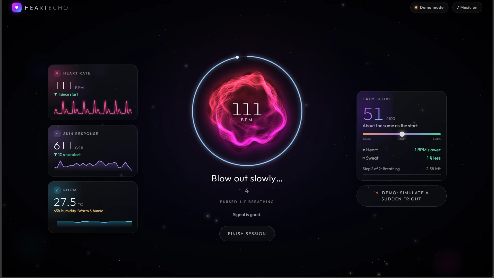

# HeartEcho

A biofeedback web app that reads your heart rate, skin response and room conditions from an Arduino and guides you through a short calming session.



## Features

- Live heart rate, pulse wave and skin response (GSR) readings
- Room temperature and humidity
- A calm score that compares you to how you were at the start
- Guided breathing with background music
- A before-and-after report when the session ends
- Demo mode with simulated data, so no hardware is needed

## How a session works

1. **Baseline** – 20 seconds of measuring your starting state
2. **Calming** – breathing guide and music while your readings are tracked
3. **Report** – before vs. after comparison

## Hardware

- Arduino connected over USB
- Pulse sensor
- GSR sensor
- DHT22 temperature and humidity sensor

The Arduino sends one message per line at 115200 baud:

```
BPM:72
BEAT
W:-35
GSR:430
ROOM:27.4,68
NOFINGER
```

The browser connects to it through the Web Serial API, so use Chrome or Edge.

## Getting started

```bash
npm install
npm run dev
```

Open [http://localhost:3000](http://localhost:3000), then connect the Arduino or start demo mode.

## Tech stack

Next.js, React, TypeScript, Tailwind CSS, Three.js
